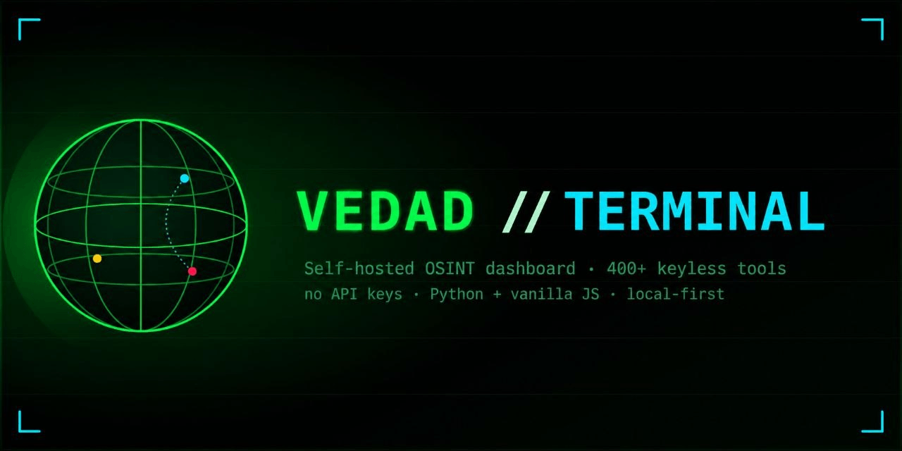
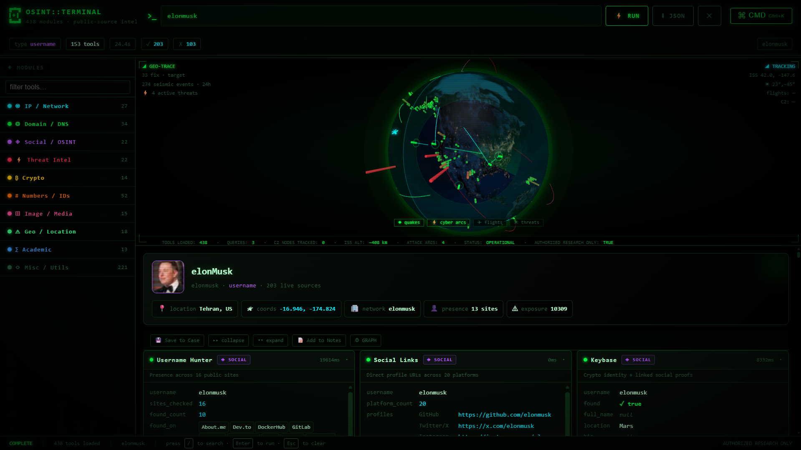

<p align="center">
  
</p>

<p align="center">
  A self-hosted OSINT dashboard exposing <b>438 keyless investigation tools</b> through a
  single-file Python server and a dependency-free web UI.<br>
  Every tool relies only on free, public data sources — <b>no API keys, no accounts, no telemetry</b>.
</p>

<p align="center">
  
  
  
  
  
</p>

> ### ⚠️ Legal & responsible use
> This project is for **authorized security research, education, and defensive
> investigation only**. You are responsible for complying with all applicable laws
> and for having explicit permission before investigating any target. The tools query
> public data sources and perform read-only lookups; do not use them to harass,
> stalk, or gain unauthorized access. See [SECURITY.md](SECURITY.md) for the full
> responsible-use policy.


<p align="center">
  
</p>

## Highlights

- **438 keyless tools** spanning network, domain, email, identity, phone, image,
  crypto, threat-intel, academic, geo, and encoding categories.
- **Interactive 3D globe** (via [globe.gl](https://globe.gl)) with live overlays:
  earthquakes (USGS), aircraft (OpenSky), C2 infrastructure (Feodo Tracker),
  ISS position, and animated attack arcs.
- **Investigation workflow** — group results into named cases, pivot across related
  indicators, and run batch queries across many tools and targets at once.
- **Zero heavy dependencies** — the backend is the Python standard library plus
  `requests`; the frontend is vanilla JavaScript with no build step.
- **Local-first** — history, stats, favorites, and cases persist to plain JSON on
  disk. Nothing leaves your machine except the outbound lookups you trigger.

## Quick start

Requires **Python 3.10+**.
```bash
git clone https://github.com/tvedad/Vedad-Terminal.git
cd Vedad-Terminal
pip install -r requirements.txt
python server.py
```

Then open http://localhost:8080.

On Windows the commands are identical from PowerShell or cmd; use py instead of
python if that is how Python is registered on your system.

Verify the install without starting the server:


          
```bash
python server.py --selftest
```

# -> SELFTEST OK (438 tools registered)
Run with Docker
bash
docker build -t vedad-terminal .
docker run --rm -p 8080:8080 -v "$(pwd)/data:/app/data" vedad-terminal
The -v mount persists the result cache, history, and stats across container
restarts. Set a different port with -e PORT=9000 -p 9000:9000.

Configuration
The server reads two optional environment variables:

Variable	Default	Purpose
PORT	8080	HTTP port to bind.
CACHE_TTL	3600	Result-cache lifetime, in seconds.
bash
PORT=9000 CACHE_TTL=600 python server.py
Every tool works with no API key, account, or token — there is nothing to configure
before running.

Dependencies
Package	Required	Enables
requests	yes	HTTP-based lookups (most tools).
Pillow	optional	Image EXIF / GPS / perceptual-hash tools.
phonenumbers	optional	Richer offline phone-number parsing.
Tools whose optional dependency is missing degrade gracefully — they return an
explanatory message instead of failing.

API
The server is a thin JSON API over the tool registry in osint.py.

Method	Endpoint	Description
GET	/api/tools	Tool registry metadata (label, accepts, desc)
GET	/api/run/<tool>?q=<input>	Run a single tool and return its JSON result
GET/POST	/api/batch	Run many {tool, query} pairs in parallel
GET	/api/history	Recent queries
DELETE	/api/history	Clear history
GET	/api/stats	Per-tool usage and latency stats
GET	/api/favorites	List / add / remove favorite tools
GET	/api/export?format=csv|json	Export history
GET	/api/cases	List saved cases
GET/POST/DELETE	/api/cases/<name>	Read / append-to / delete a case
GET	/api/health[?force=1]	Smoke-test tools against known fixtures
GET	/api/threat?q=<ioc>	Check an IP/URL/hash against IOC blocklists
GET	/api/threat-feed	Geo-resolved C2 points for the globe
GET	/api/cache/stats	Result-cache size and TTL
GET	/api/cache/clear	Clear the result cache
Example:

```bash
curl "http://localhost:8080/api/run/dns?q=example.com"
curl "http://localhost:8080/api/run/ipgeo?q=8.8.8.8"
curl -X POST "http://localhost:8080/api/batch" \
  -H "Content-Type: application/json" \
  -d '{"queries":[{"tool":"dns","query":"example.com"},{"tool":"tls","query":"example.com"}]}'
```

Tool categories
All 438 tools are keyless and grouped by the indicator type they accept. The UI
auto-detects the input type (IP, domain, email, phone, coordinates, hash, and 25+
others) and filters the sidebar accordingly.

Category	Example tools
IP / Network	IP geolocation, ASN/BGP, reverse DNS, port scan, Tor-exit check
Domain / Web	DNS, WHOIS/RDAP, subdomains, TLS certs, security headers, tech stack
Email	MX/SPF/DMARC posture, Gravatar, disposable detection, breach lookup
Identity	Username hunting, GitHub/GitLab, Bluesky, Keybase, HackerNews
Phone	E.164 parsing, carrier, region, timezone (offline)
Image	EXIF, GPS extraction, perceptual hashing
Crypto	BTC/ETH address & transaction lookups, wallet validation
Threat intel	IOC reputation, CVE detail, MITRE ATT&CK, C2/malware feeds
Academic	arXiv, PubMed, DBLP, Wikidata, ORCID
Geo	Reverse geocode, sun times, earthquakes, ISS, flights
Encoding	Base64/32, hex, morse, ROT-13, Caesar, JWT decode
Browse the full registry at runtime via GET /api/tools or the sidebar.

Architecture
text
index.html   Single-page dashboard — vanilla JS/CSS, globe.gl loaded from CDN.
server.py    Stdlib ThreadingHTTPServer: routing, caching, persistence, batch pool.
osint.py     The tool registry — 438 functions, each query -> dict, keyless sources.
Backend: http.server.ThreadingHTTPServer — no Flask/Django. Responses are
gzip-compressed; the tool catalog and static page are memoized and ETag-cached.

Concurrency: batch and health checks fan out over a ThreadPoolExecutor.

Persistence: history, stats, favorites, and result cache live under data/;
cases live under cases/. Both directories are created on first run and are
git-ignored so investigation data never gets committed.

See docs/ARCHITECTURE.md for a deeper walkthrough.

Contributing
Contributions are welcome — new keyless tools especially. See
CONTRIBUTING.md for the tool contract, coding conventions, and
how to run the self-test. Please also read the
Code of Conduct.

Security
To report a vulnerability or a tool that behaves unsafely, see
SECURITY.md. Please do not open public issues for security reports.

License
Released under the MIT License.

Acknowledgements
Data is sourced from free, public providers including USGS, OpenSky Network,
abuse.ch (Feodo Tracker, URLhaus, MalwareBazaar), crt.sh, RDAP registries,
OpenStreetMap Nominatim, and many others. Please respect each provider's terms of
use and rate limits.

<div align="center">
Made with ❤️ by the Vedad Security Team

⬆ back to top

</div>
